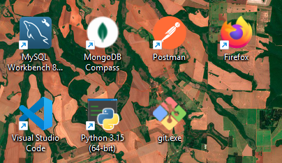

# Ejercicios de clases de Python

este repositorio sigue mis resoluciones (e intentos) de los ejercicios basados en los propuestos por el profesor Antonio, en éstos repositorios:
- [inciciación a python](https://github.com/amartinsierra/python_oct_26/),
- [manipulación de archivos](https://github.com/amartinsierra/python_persistencia),
- [programación orientada a objetos](https://github.com/amartinsierra/python_poo)
- [tecnologías web de python](https://github.com/amartinsierra/python_web)

### Recursos
[PDF´s y recursos de aprendizaje de Saúl](/assets) \
[Repo de recursos de Antonio](https://github.com/amartinsierra/recursos_curso_python/tree/main)

> **Aplicaciones usadas durante el curso:** \
> 

#### Notas sobre entornos virtuales:
El profesor ha decidido usar entornos virtuales de python .venv distintos, de ahí que el curso se separa en múltiples repositorios. Yo he utilizado un solo entorno virtual. Se pueden ver los requerimientos de python para éste proyecto, en: _venv-requirements.txt_.